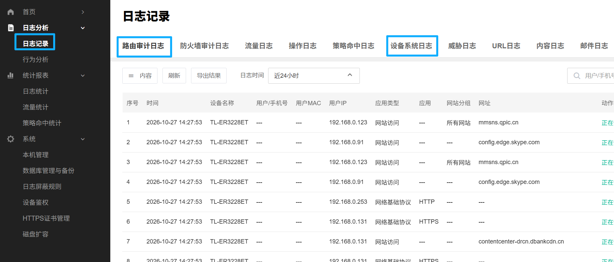
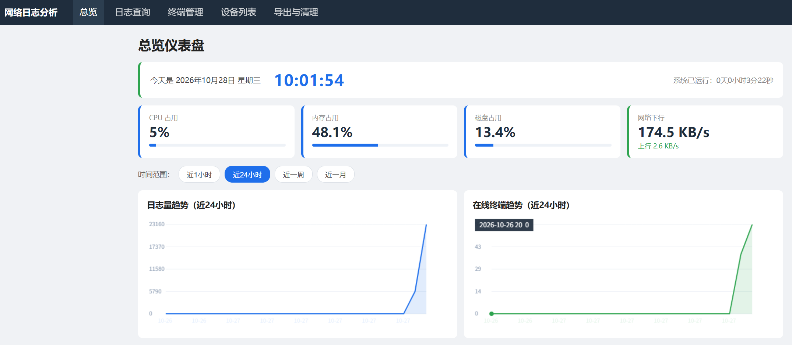
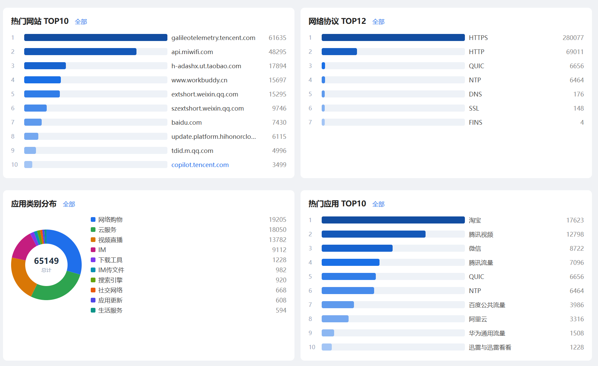
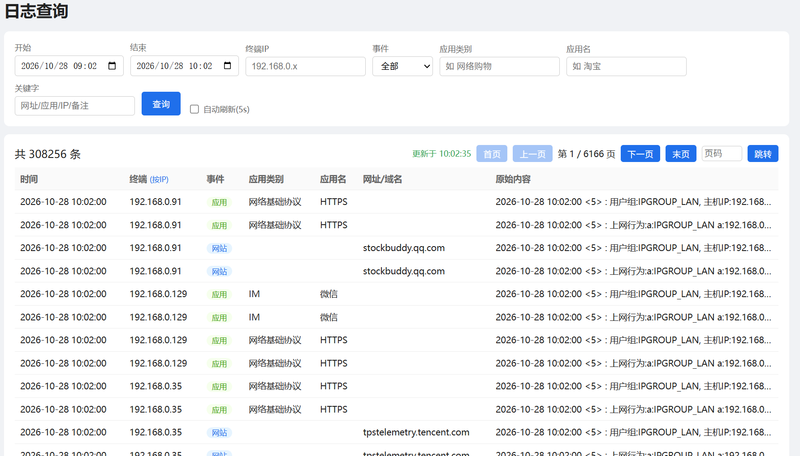
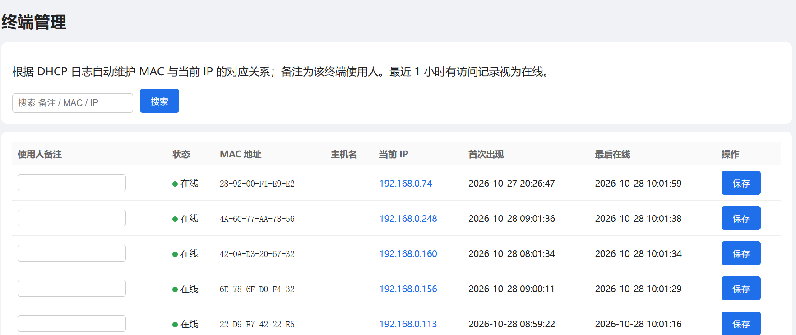
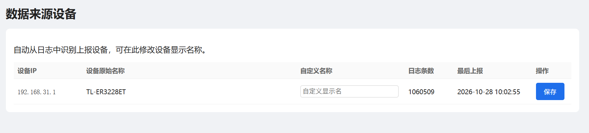

# TPLink 上网行为审计（SyslogAudit）v2.1

一款**替代 TP-Link 官方审计软件**的开源上网行为审计系统。面向 TP-Link ER3228ET（理论上所有tplink带行为审计的企业路由器都支持） 等支持 syslog 远程日志的路由器/网络设备，自动采集终端上网日志并提供现代化的 **Web 可视化审计后台**。

> 官方审计软件简直了，必须用win10+特殊版本virtualbox+插件，运行的openwrt魔改固件，谁家企业用台物理pc做服务器啊；为什么做这个软件就是因为我被折磨了一整天，原本想转换格式安装到esxi上，各种尝试后最后只能esxi安装虚拟机win10，win10里安装virtualbox，再运行虚拟机。。。。打开一看界面，路由器除了显示一个日志列表，其它菜单全是为防火墙准备的，完全没用。一气之下就让豆包写了本系统，花了3个小时，本项目提供**一键部署、零外网依赖、现代可视化**的替代方案。

---

## 为什么替代官方软件

| 维度 | 官方审计软件 | 本系统（SyslogAudit） |
|---|---|---|
| 安装 | 必须特殊版本的vbox安装，环境依赖多，易失败 | 拷贝文件夹 → 右键 `install.bat` 以管理员运行，**一键完成**（自动装 Python/依赖/防火墙/开机自启） |
| 依赖 | 需要外网安装环境 | 内置离线依赖包（`packages/`），无需外网 |
| 界面 | 简陋、路由器完全只有一个列表（见下方对比截图） | 现代 Web 后台：总览仪表盘、日志查询、终端管理、统计报表、导出与清理 |
| 稳定性 | — | 看门狗自愈（进程崩溃 5 秒自动重启），日志留痕 |
| 运行 | — | SYSTEM 开机自启，脱离宿主进程独立运行 |

## 主要功能

- **总览仪表盘**：实时显示 CPU/内存/磁盘占用、网络上下行速率，日志量与在线终端趋势曲线。
- **日志查询**：按时间、终端 IP、事件、应用类别、应用名、关键字多维筛选，支持 5 秒自动刷新与分页浏览。
- **统计报表**：热门网站 TOP10、网络协议 TOP12、应用类别分布（饼图）、热门应用 TOP10。
- **终端管理**：依据 DHCP 日志自动维护 MAC ↔ IP ↔ 主机名映射，标注使用人备注，最近 1 小时有访问记为在线。
- **设备列表（数据来源设备）**：自动识别上报设备（如 TL-ER3228ET），可自定义显示名称。
- **导出与清理**：按时间段导出 CSV、导入历史 CSV（TP-Link 格式）、日志保留天数设置、重启服务。
- **多类日志**：路由审计日志、防火墙审计日志、流量日志、操作日志、策略命中日志、设备系统日志、威胁日志、URL 日志、内容日志、邮件日志。
- **日志采集**：UDP 514 接收 syslog，自动解析设备、终端 IP、MAC、应用类别、网址/域名、动作等。

## 界面截图

- **官方简陋界面**：除了蓝框的三个可以看其它都是摆设，这不就是个列表，跟我看文本log有啥区别。

  

## 本系统界面
- **01-总览仪表盘**：系统运行时长、CPU/内存/磁盘、网络上下行，日志量与在线终端近 24 小时趋势。

  

- **02-统计报表**：热门网站 TOP10、网络协议 TOP12、应用类别分布、热门应用 TOP10。

  

- **03-日志查询**：多维筛选查询，共 N 条日志，分页浏览，支持自动刷新。

  

- **04-终端管理**：自动维护 MAC/IP/主机名映射，标注使用人，识别在线状态。

  

- **05-数据来源设备**：自动识别上报设备，修改自定义显示名称。

  

- **06-导出与清理**：导出 CSV、导入历史 CSV、日志保留天数、重启服务。

  

## 安装步骤（v2.1，Windows 10 / Server 2016+）

1. **拷贝**：将整个 `syslog-v2.1` 文件夹拷贝到目标机器任意目录（**路径不要含中文和空格**，如 `D:\syslog\`）。
2. **一键安装**：右键 `install.bat` → **以管理员身份运行**。脚本自动完成：
   - 检测/安装 Python 3.11（自动 `winget` 安装）；
   - 安装依赖（优先本地 `packages/` 离线包，失败自动回退清华 PyPI 镜像）；
   - 创建 `data/` 数据目录（数据库）；
   - 防火墙放行 **UDP 514**（收日志）与 **TCP 8080**（网页）；
   - 注册 **SYSTEM 开机自启**（无需登录即运行），经看门狗自愈；
   - 启动服务并验证。
3. **访问后台**：浏览器打开 `http://服务器实体网卡IP:8080/`，默认账号 `admin` / 密码 `admin123`，**登录后立即修改密码**。
4. **配置路由器日志指向**（TP-Link ER3228ET）：
   - 系统工具 → 远程日志；
   - 日志服务器 IP：填本机**实体网卡 IP**（install.bat 会自动检测并显示）；
   - 端口 `514`，协议 `UDP`，日志级别：信息 / 行为管控。

> 说明：服务经 SYSTEM 计划任务独立于任何宿主进程运行；不要在豆包等应用内部手动启动，以免宿主退出时被连带终止。

## 常用操作

| 操作 | 方式 |
|---|---|
| 重启服务 | 网页"导出与清理"页底部"重启服务"，或双击 `restart.bat` |
| 停止服务 | 双击 `stop.bat` |
| 查看日志 | 网页"日志查询"页 |
| 修改保留天数 | 网页"导出与清理"页系统设置（默认 30 天，每小时自动清理） |
| 卸载自启 | 双击 `uninstall_service.bat` |
| 完全卸载+清空数据 | 双击 `uninstall_clean.bat` |

## 目录结构

```
syslog-v2.1/
├── app.py / config.py / db.py / parser.py / syslogd.py / metrics.py   # 主程序
├── watchdog.py                # 服务看门狗（自愈 + 日志）
├── install.bat                # 一键安装
├── install_service.bat        # 注册开机自启（指向看门狗）
├── restart.bat / stop.bat     # 重启 / 停止
├── uninstall_service.bat / uninstall_clean.bat
├── requirements.txt
├── packages/                  # 离线依赖包（8 个 wheel）
├── templates/ / static/       # 网页模板与前端资源
├── docs/screenshots/          # 界面截图
├── VERSION.txt                # 版本说明
└── 修改记录.md                # 完整修改记录
```

## 技术栈

Python 3.10+、Flask、SQLite、psutil；前端原生 HTML/CSS/JS + ECharts 图表。

## 版本

- **v2.1**（2026-10-28）：修复官方替代目标相关的安装与环境问题，新增看门狗自愈与脱离宿主独立运行。详见 `修改记录.md`。
